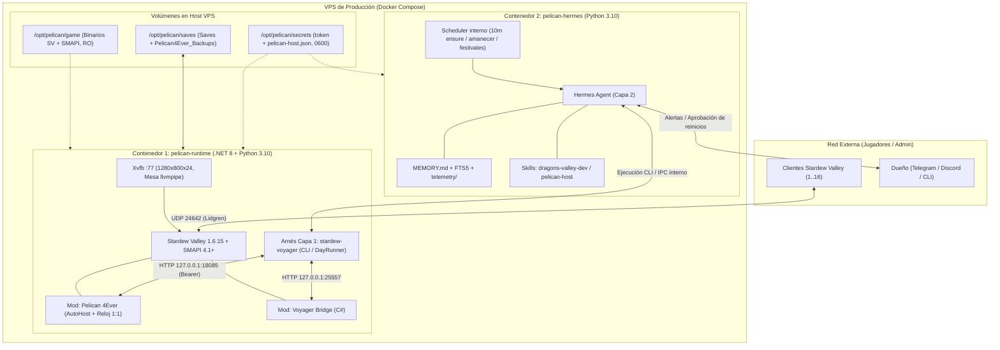

# Arquitectura de Producción: Pelican 4Ever + Stardew Voyager + Hermes (Nivel C)

Este documento define la arquitectura objetivo para empaquetar y desplegar en una **VPS de producción (mediante contenedores Docker)** el ecosistema completo de servidor persistente multijugador: **Stardew Valley 1.6.15 (Headless)**, **Pelican 4Ever**, **Stardew Voyager** y **Hermes Agent** en **Nivel C** (administración autónoma del contenedor, rol de anfitrión y jugador físico con planificación cognitiva), manteniendo compatibilidad total con el entorno actual de pruebas sobre **OpenClaw**.

---

## 1. Estrategia Dual: Pruebas en OpenClaw y Producción en Hermes

La arquitectura separa limpiamente las responsabilidades según el principio rector de Voyager (**«La skill dirige; el arnés ejecuta; el juego decide»**):

* **Componentes compartidos entre ambos entornos (100% reutilizables sin cambios):**
  1. **Capa 0 (Juego + Mods C#):** `Pelican 4Ever` (`/api/v1/host/*`) y el puente de Voyager (`bridge/`).
  2. **Capa 1 (Arnés Determinista Python):** El paquete CLI `stardew-voyager` (`voyager --live host ensure|status`, `DayRunner`, `HostRunner`, `scheduler.py`, `watchdog.py`).
  3. **Contrato de Skills (`SKILL.md`):** Tanto **OpenClaw** como **Hermes Agent** implementan el estándar abierto `SKILL.md` (`agentskills.io`). Las skills `dragons-valley-dev`, `dragons-day-routine` y `pelican-host` son portables entre ambos arneses de Capa 2.

* **Ventaja operativa:**
  El desarrollo y depuración continúan con Dr4co sobre **OpenClaw** en local (líneas `desarrollo` y `preproduccion` descritas en [`docs/deployment-lines.md`](deployment-lines.md)), mientras que la imagen de producción para VPS empaqueta únicamente un stack **`.NET + Python` (Voyager + Hermes)** sin necesidad de incluir Node.js ni el gateway de OpenClaw.

---

## 2. Topología de Contenedores (Nivel C en VPS)

Para producción se define un despliegue `docker-compose` de **dos contenedores acoplados por loopback compartido**, separando el proceso crítico del juego (`pelican-runtime`) del agente de Capa 2 (`pelican-hermes`).



### Motivos para separar `pelican-runtime` y `pelican-hermes`
1. **Cero interrupciones a los jugadores:** Stardew Valley solo guarda al cambiar de día (`02:00 AM`). Si es necesario actualizar Hermes, ajustar una skill, cambiar de modelo LLM o reiniciar el bucle de Capa 2, se puede reiniciar `pelican-hermes` en caliente sin tocar el proceso `StardewModdingAPI`.
2. **Aislamiento de datos:** `pelican-hermes` no monta la carpeta `Saves/`; solo interactúa con el servidor mediante los comandos autorizados de `voyager` y la [API de Anfitrión v1](host-api.md).

---

## 3. Ejecución Headless y Volumen Montado de Stardew Valley

### 3.1. Pantalla Virtual Sin Monitor (`Xvfb` + `llvmpipe`)
MonoGame/SDL2 requiere inicializar un contexto X11/OpenGL para arrancar `Stardew Valley.dll`, y el `watchdog` de Voyager necesita poder capturar pantalla (`/screenshot`) ante un incidente físico:
* El contenedor `pelican-runtime` levanta **`Xvfb :77 -screen 0 1280x800x24 -nolisten tcp -noreset`** antes de ejecutar `StardewModdingAPI`.
* Utiliza renderizado por software en CPU mediante `libgl1-mesa-dri` (`llvmpipe`), sin requerir GPU en la VPS ni exponer puertos VNC.

### 3.2. Aprovisionamiento de Stardew Valley por Volumen Montado (`/opt/pelican/game`)
Para respetar la licencia del juego y evitar descargas o bloqueos de Steam Guard al recrear contenedores:
* La copia Linux (`x86_64`) de **Stardew Valley 1.6.15** con **SMAPI 4.1+** se instala una única vez en el host de la VPS bajo `/opt/pelican/game` (siguiendo el mismo patrón de `~/.local/share/pelican4ever/preprod/game` en [`docs/deployment-lines.md`](deployment-lines.md)).
* El contenedor `pelican-runtime` monta `/opt/pelican/game` en modo **solo lectura (`:ro`)** e inyecta encima por bind-mount los artefactos compilados de `Mods/Pelican4Ever` y `Mods/StardewVoyagerBridge`.

---

## 4. Responsabilidades por Capa en Producción

| Capa | Componente | Responsabilidades en Producción |
| :--- | :--- | :--- |
| **Capa 0 (Motor y Mundo)** | **Stardew Valley + Pelican 4Ever + Bridge** | - Cargar automáticamente la partida al iniciar (`AutoHostSaveName`).<br>- Mantener el reloj 1:1 (`600_000 ms` / 10 min) y congelar la madrugada (`NightHold` en `2550`).<br>- Ejecutar el cambio de día (`02:00 AM`) con backup SHA-256 verificable y ventana de mantenimiento (`MaintenanceWindowMinutes: 25`).<br>- Exponer `/api/v1/host/*` (`18085`) y el puente físico (`25557`) exclusivamente en `127.0.0.1`. |
| **Capa 1 (Arnés de Ejecución)** | **`stardew-voyager` (Python CLI)** | - **Perfil `multiplayer_host`:** prohibir `/pause` (`Game1.paused`) y recargas de partida.<br>- Ejecutar físicamente el `DayPlan` en su propia residencia (`Pelican4Ever_Farm_XX`) con A*, uso de herramientas y `watchdog` local.<br>- Registrar el descanso en cama mediante `rest_in_bed` (`POST /api/v1/host/rest` con `AgentHost: true`) sin cerrar la sesión.<br>- Ejecutar las guardas de `voyager --live host ensure` y `voyager --live host status`. |
| **Capa 2 (Orquestador Cognitivo)** | **Hermes Agent** | - **Guardián (cada 10 min):** Invocar `voyager --live host ensure`. Si devuelve `report` o `refuse`, enviar alerta con logs saneados al dueño por Telegram/Discord.<br>- **Planificador Matutino (`06:00 AM`):** Leer el estado del amanecer, generar el relato diario con la skill `dragons-day-routine`, compilar el `DayPlan` y lanzar `DayRunner`.<br>- **Anfitrión Social (`18:00–23:50`):** En días de festival (`GET /api/v1/host/festival`), anunciar convocatorias (`POST /announce`), arrancar tandas para vecinos inscritos (`POST /festival/start`) o ceremonias (`POST /festival/ceremony`).<br>- **Memoria Continua:** Persistir en `MEMORY.md` el progreso estacional de su granja y el historial de incidencias del servidor. |

---

## 5. Diseño de `docker-compose.prod.yml`

```yaml
services:
  pelican-runtime:
    build:
      context: .
      dockerfile: deploy/docker/Dockerfile.runtime
    container_name: pelican-runtime
    restart: unless-stopped
    ports:
      - "24642:24642/udp" # Único puerto expuesto al exterior (Lidgren Multiplayer)
    environment:
      - DISPLAY=:77
      - TZ=Europe/Madrid
      - STARDEW_DIR=/game
      - XDG_CONFIG_HOME=/data/xdg/config
      - XDG_DATA_HOME=/data/xdg/data
      - PELICAN_HOST_URL=http://127.0.0.1:18085
      - PELICAN_HOST_TOKEN_FILE=/run/secrets/pelican_admin_token
    volumes:
      - /opt/pelican/game:/game:ro
      - /opt/pelican/mods/Pelican4Ever:/game/Mods/Pelican4Ever:ro
      - /opt/pelican/mods/StardewVoyagerBridge:/game/Mods/StardewVoyagerBridge:ro
      - /opt/pelican/config/pelican4ever.config.json:/game/Mods/Pelican4Ever/config.json:ro
      - /opt/pelican/saves:/data/xdg/config/StardewValley
      - /opt/pelican/telemetry:/workspace/telemetry
    secrets:
      - pelican_admin_token
      - pelican_host_auth

  pelican-hermes:
    build:
      context: .
      dockerfile: deploy/docker/Dockerfile.hermes
    container_name: pelican-hermes
    restart: unless-stopped
    network_mode: "service:pelican-runtime" # Comparte loopback (127.0.0.1:18085 y :25557) sin exponer puertos
    environment:
      - TZ=Europe/Madrid
      - PELICAN_HOST_URL=http://127.0.0.1:18085
      - PELICAN_HOST_TOKEN_FILE=/run/secrets/pelican_admin_token
      - PELICAN_HOST_AUTHORIZATION=/run/secrets/pelican_host_auth
      - STARDEW_BRIDGE_URL=http://127.0.0.1:25557
      - STARDEW_VOYAGER_HOME=/workspace/stardew-voyager
    volumes:
      - /opt/pelican/telemetry:/workspace/telemetry
      - /opt/pelican/hermes:/root/.hermes
    secrets:
      - pelican_admin_token
      - pelican_host_auth
      - llm_api_key

secrets:
  pelican_admin_token:
    file: /opt/pelican/secrets/token
  pelican_host_auth:
    file: /opt/pelican/secrets/pelican-host.json
  llm_api_key:
    file: /opt/pelican/secrets/llm_api_key
```

> **Nota de red (`network_mode: "service:pelican-runtime"`):** Al compartir el namespace de red local del contenedor `pelican-runtime`, **Hermes** y el CLI de **Voyager** acceden directamente a `127.0.0.1:18085` (API de Anfitrión) y `127.0.0.1:25557` (Voyager Bridge) manteniendo `AdminApiBindAllInterfaces: false` en `Pelican4Ever`. Ninguna API HTTP queda expuesta fuera del loopback.

---

## 6. Ciclo de Actualización y Mantenimiento en Producción

1. **Parches de Mods (`Pelican4Ever` o `Bridge`) sin pérdida de progreso:**
   * Se despliegan los nuevos `.dll` en `/opt/pelican/mods/`.
   * Hermes (con aprobación del dueño) invoca `POST /api/v1/host/restart` con `{"immediate": false, "warningMinutes": 10, "reason": "Actualización de servidor"}`.
   * Pelican 4Ever espera al cambio de día (`02:00 AM`), guarda la partida, verifica el backup SHA-256, activa `MaintenanceWindowMinutes` y, gracias a `RestartExitsProcess: true`, cierra el proceso de SMAPI.
   * El contenedor relanza `StardewModdingAPI` cargando los nuevos binarios y `AutoHostSaveName` reabre la partida automáticamente.
2. **Actualización del Agente (Hermes o Skills):**
   * Se reinicia únicamente el contenedor `pelican-hermes` (`docker compose -f docker-compose.prod.yml restart pelican-hermes`). La partida en `pelican-runtime` permanece en línea sin desconectar a ningún jugador.

---

## 7. Hoja de Ruta de Transición (De OpenClaw a Hermes en Producción)

1. **Fase 1 — Completar el perfil Host en local con OpenClaw:**
   * Cerrar y probar en local las tareas del cruce Voyager ↔ Pelican (`SV-123` a `SV-131`: bloqueo de `/pause` en modo host, `rest_in_bed`, observación de residencia `Pelican4Ever_Farm_XX`, `HostRunner` y subskill `skills/pelican-host/SKILL.md`).
2. **Fase 2 — Empaquetar `pelican-runtime` (Capas 0 + 1):**
   * Crear `deploy/docker/Dockerfile.runtime` con `Xvfb`, `.NET 8`, `Python 3.10`, `Pelican4Ever`, `Voyager Bridge` y el CLI `stardew-voyager`, montando `/opt/pelican/game` desde el host.
3. **Fase 3 — Integrar `pelican-hermes` (Capa 2):**
   * Configurar `deploy/docker/Dockerfile.hermes` cargando las mismas carpetas `skills/` (`dragons-valley-dev`, `dragons-day-routine`, `pelican-host`) y definir los triggers horarios de Hermes (cada 10 min `host ensure`, `06:00` planificación diaria, `18:00` vigilancia de festivales).
