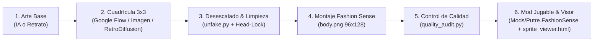

# Pipeline de Creación y Desescalado de Pixel Art para Stardew Valley (Fashion Sense)

Este documento resume la arquitectura integrada para generar, desescalar, auditar y empaquetar skins de personajes 16-bit compatibles con Stardew Valley.

---

## 1. Componentes del Pipeline



### A. Generación
- Cuadrícula 3×3 con fondo blanco puro `#FFFFFF`, sin textos, con separación de piernas (*espacio negativo*).
- Poses estándar: Fila 1 (Frontal), Fila 2 (Perfil derecho $\rightarrow$), Fila 3 (Trasera).

### B. Desescalado Inteligente (`unfake.py`)
- Muestreo por **color dominante / contenido adaptativo** con aceleración en Rust.
- Binarización de canal alfa ($0 < \alpha < 255 \rightarrow 0 \text{ ó } 255$).
- Eliminación de artefactos de compresión y alineación estricta de bordes.

### C. Post-Procesado Especializado SDV
- **Head-Lock**: Fija la cabeza del fotograma en reposo sobre los pasos para eliminar jitter.
- **Rebote vertical**: Desplazamiento dinámico de $+1\text{px}$ en los pasos de marcha.
- **Sel-out**: Contorno exterior oscuro cálido y costuras interiores con sombra de material.

### D. Control de Calidad (`quality_audit.py` de la skill `pixel-art`)
- Valida automáticamente:
  - 0 píxeles semitransparentes.
  - 0 píxeles huérfanos / ruido suelto.
  - Paleta respetada ($\le 25$ colores).
  - Dimensiones alineadas a cuadrícula ($96\times 128$).

---

## 2. Herramientas Interactivas Disponibles

- **Visor interactivo en el navegador:**
  - Abre en tu navegador [`agents/sprite_viewer.html`](../agents/sprite_viewer.html) para probar cualquier skin en las 4 direcciones, pausar, avanzar paso a paso y ajustar zoom y velocidad.
- **Auditoría por comando:**
  ```bash
  python3 .agents/skills/pixel-art/scripts/quality_audit.py --image agents/Putre/body.png --grid 8
  ```

---

## 3. Preparación para RetroDiffusion

RetroDiffusion ofrece dos vías de conexión para generar directamente pixel art nativo de baja resolución sin necesidad de desescalar:

### Opción A: Servidor MCP (Recomendado para el agente)
RetroDiffusion cuenta con un servidor oficial del Model Context Protocol:
- Endpoint: `https://mcp.retrodiffusion.ai/mcp`
- Permite invocar la generación de sprites, turnarounds y paletas como herramientas nativas en el chat.

### Opción B: API REST / Replicate
- Endpoints públicos en Replicate: `retro-diffusion/rd-fast` y `retro-diffusion/rd-plus`.
- API REST directa en `https://api.retrodiffusion.ai/v2`.
- Parámetros clave: `width: 24, height: 32, style: "rpg_character", palette: "custom"`.
