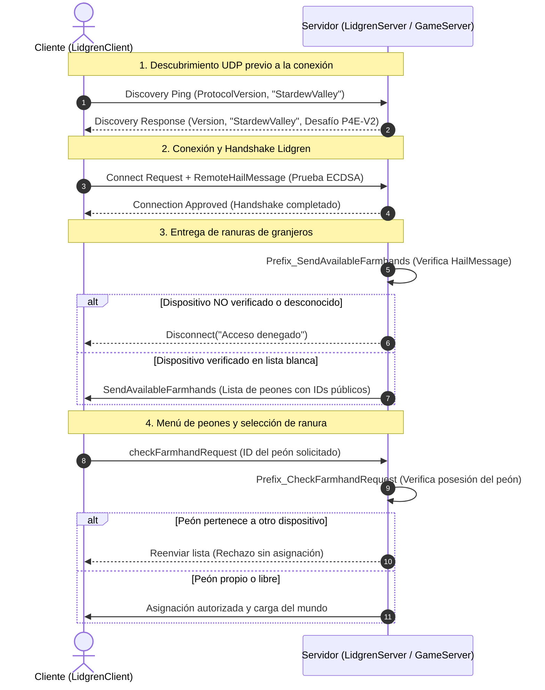

# Protocolo de Identidad por Dispositivo, Modelo de Amenazas y Prueba Lidgren (TASK-1801)

Este documento establece la arquitectura criptográfica, el modelo de amenazas, la auditoría de fugas de credenciales heredadas y el análisis del enlace con Lidgren para la Épica 18 de Pelican 4Ever.

---

## 1. Secuencia y Límites en Stardew Valley 1.6.15 / SMAPI / Lidgren

### 1.1 Flujo de Red Nativo en Conexión Directa por IP

En Stardew Valley multijugador nativo sobre Lidgren (UDP):



### 1.2 Límites de Inyección en Lidgren

1. **`LidgrenServer.sendVersionInfo(NetIncomingMessage message)`**:
   - Se ejecuta cuando el servidor recibe un paquete de descubrimiento UDP antes de establecer la conexión formal.
   - En este punto, el servidor inyecta el desafío criptográfico `P4E\x02` en la respuesta de descubrimiento (`SendDiscoveryResponse`).
2. **`LidgrenClient.receiveHandshake(NetIncomingMessage msg)`**:
   - En el cliente, este método procesa la respuesta de descubrimiento. Si detecta el marcador `P4E\x02`, extrae el desafío, firma el contexto con la clave privada local del dispositivo y llama a `__instance.client.Connect(ip, port, hailMessage)`, adjuntando la prueba en el *hail message* del handshake de Lidgren.
3. **`GameServer.sendAvailableFarmhands(string userId, string connectionId, Action<OutgoingMessage> sendMessage)`**:
   - Invocado por Stardew inmediatamente después de que la conexión UDP queda establecida.
   - **Límite clave en Stardew:** En conexión IP directa nativa, `userId` llega siempre como cadena vacía (`""`), porque Stardew no dispone de un SDK externo (Steam/GOG) para rellenarlo.
   - Nuestro prefijo Harmony intercepta esta llamada **antes** de que se serialice ningún personaje. Resuelve la instancia de `NetConnection` a partir de `connectionId`, examina `connection.RemoteHailMessage` y comprueba la validez de la firma ECDSA.
   - Si la prueba no es válida o el dispositivo no está autorizado, se corta la conexión y se devuelve `false`, impidiendo que la lista de peones viaje por la red.
4. **`GameServer.checkFarmhandRequest(ref string userId, string connectionId, NetFarmerRoot farmer, ...)`**:
   - Invocado cuando el usuario hace clic en una ranura del menú `FarmhandMenu`.
   - El prefijo Harmony comprueba que la ranura solicitada coincida con el `BoundPlayerId` asociado a la clave pública verificada de la conexión. Si un cliente autorizado intenta reclamar el personaje de otro jugador, la solicitud se rechaza y se reenvía la lista sin asignar el personaje.

---

## 2. Especificación Criptográfica del Protocolo `P4E\x02`

### 2.1 Primitivas Criptográficas

- **Algoritmo de firma:** ECDSA sobre la curva elíptica estándar NIST P-256 (`secp256r1` / `ECCurve.NamedCurves.nistP256`).
- **Función hash:** SHA-256 (`HashAlgorithmName.SHA256`).
- **Formato de firma:** IEEE P1363 compacto de 64 bytes ($R$ de 32 bytes concatenado con $S$ de 32 bytes), compatible de forma nativa en Linux y Windows a través de `System.Security.Cryptography.ECDsa` sin dependencias externas.
- **Formato de clave pública:** X.509 SubjectPublicKeyInfo (SPKI, DER) de ~91 bytes.
- **Huella digital del dispositivo (`DeviceFingerprint`):** Hash SHA-256 en formato hexadecimal en minúsculas (64 caracteres) calculado sobre los bytes SPKI de la clave pública. Representación pública no secreta.

### 2.2 Estructura del Desafío del Servidor (`ServerChallenge`)

Emitido en `sendVersionInfo` tras la cabecera nativa de Stardew:

| Campo | Tipo / Tamaño | Descripción |
| :--- | :--- | :--- |
| **Marker** | 4 bytes | Constante mágica `0x50, 0x34, 0x45, 0x02` (`P4E\x02`). |
| **ProtocolVersion** | 1 byte | Valor `0x02` (Protocolo v2 asimétrico). |
| **ServerSessionId** | 16 bytes | GUID aleatorio generado por el host al cargar la partida. Evita reutilizar desafíos en otros servidores o sesiones. |
| **TimestampUtc** | 8 bytes | Timestamp Unix en milisegundos (UTC). |
| **Nonce** | 32 bytes | 32 bytes aleatorios criptográficos (`RandomNumberGenerator`). |

- **Vida útil:** 30 segundos exactos desde su emisión.
- **Un solo uso:** El nonce se consume y elimina de la memoria del servidor en el primer intento de verificación, tenga éxito o fracase.
- **Capacidad acotada:** Máximo 1024 desafíos simultáneos con desalojo LRU/expiración para evitar ataques de agotamiento de memoria.

### 2.3 Estructura de la Respuesta del Cliente (`HailMessage`)

Transmitida en `RemoteHailMessage` durante el handshake de Lidgren:

| Campo | Tipo / Tamaño | Descripción |
| :--- | :--- | :--- |
| **Marker** | 4 bytes | Constante mágica `0x50, 0x34, 0x45, 0x02`. |
| **Nonce** | 32 bytes | Nonce recibido en el desafío. |
| **TimestampUtc** | 8 bytes | Timestamp recibido del servidor. |
| **PublicKeyLength** | 2 bytes (uint16 big-endian) | Longitud de la clave pública SPKI (~91 bytes). |
| **PublicKeySpki** | Variable (~91 bytes) | Clave pública del dispositivo del cliente. |
| **Signature** | 64 bytes | Firma ECDSA IEEE P1363 calculada sobre el bloque canónico. |

### 2.4 Bloque Canónico Firmado

Los datos firmados por el cliente se componen de:

$$\text{DataToSign} = \text{"P4E-AUTH-V2"} \parallel \text{ServerSessionId} (16\text{B}) \parallel \text{TimestampUtc} (8\text{B}) \parallel \text{Nonce} (32\text{B}) \parallel \text{TargetEndpoint}$$

Esto garantiza que la firma queda estrictamente vinculada a la sesión del servidor, al tiempo actual, al nonce unívoco y a la dirección destino del servidor.

---

## 3. Modelo de Amenazas

| Vector de Amenaza | Riesgo / Impacto | Mitigación en `P4E\x02` | Resultado / Rechazo Seguro |
| :--- | :--- | :--- | :--- |
| **1. Suplantación de servidor (Rogue Host)** | Un servidor malicioso intenta engañar al cliente para que firme un desafío reutilizable contra el servidor oficial. | El cliente incluye en el bloque firmado el identificador de sesión del servidor (`ServerSessionId`) y la dirección destino (`TargetEndpoint`). Un desafío capturado por un rogue host no es válido para el host legítimo. | Si la firma no coincide con el contexto del host, la verificación falla de inmediato. |
| **2. Repetición (Replay Attack)** | Un atacante captura un paquete *hail* válido y lo retransmite para acceder al servidor. | 1) Nonce aleatorio de 32 bytes generado por el host.<br>2) Caducidad estricta de 30 s.<br>3) Consumo atómico de un solo uso: el nonce se elimina de memoria en el primer intento. | Segundo uso rechazado: `Nonce desconocido o ya consumido`. La conexión se desconecta. |
| **3. Alta no aprobada** | Un cliente desconocido genera un par de claves válido y se conecta al servidor. | Aunque demuestre posesión de su clave privada mediante firma válida, el servidor comprueba la huella en `AuthorizedDevices`. Si no está en lista blanca ni pre-aprobado por el propietario en Discord, se deniega la entrada. | El cliente no recibe la lista de granjeros. Conexión terminada con aviso para solicitar alta por DM. |
| **4. Usurpación de slot por cliente admitido** | Un jugador autorizado con su propia clave intenta seleccionar el personaje de otro jugador en el lobby. | En `Prefix_CheckFarmhandRequest`, el host verifica autoritativamente que el peón pedido pertenezca a la huella digital del dispositivo de esa conexión (`BoundPlayerId`). | Se cancela la selección, se reenvía la lista y no se asigna el personaje. |
| **5. Pérdida o corrupción de clave privada** | El jugador formatea su equipo o se corrompe su archivo de clave privada local. | El cliente genera un nuevo par de claves con una nueva huella. Al no estar autorizada la nueva clave, el acceso queda bloqueado por defecto. El propietario debe reasociar la ranura mediante el procedimiento de recuperación por DM en Putre. | Fallo cerrado seguro; nunca se concede acceso silencioso. |
| **6. Agotamiento de recursos (DoS)** | Un atacante inunda el puerto UDP con peticiones de descubrimiento o handshakes falsos. | 1) Almacén de desafíos limitado a 1024 entradas con desalojo por antigüedad.<br>2) Verificación $O(1)$ utilizando la clave pública aportada en el hail (sin búsquedas iterativas en base de datos).<br>3) Quema inmediata del nonce al primer fallo para neutralizar ataques de fuerza bruta. | Peticiones excedentes o malformadas se descartan sin consumo acumulativo de memoria o CPU. |
| **7. Degradación a versión antigua (Downgrade Attack)** | Un atacante utiliza un cliente modificado que omite el marcador `P4E\x02` para forzar el flujo heredado. | Cuando `RequirePairingWhitelist` está activo, cualquier conexión que no aporte un hail válido con `P4E\x02` es rechazada de forma tajante antes de `sendAvailableFarmhands`. No existe fallback silencioso a la vía insegura. | Desconexión inmediata con aviso de versión de mod requerida. |
| **8. Suplantación UDP / Secuestro de conexión** | Lidgren opera sobre UDP; los paquetes posteriores no van cifrados. | La autenticación vincula la prueba criptográfica a la instancia `NetConnection` de Lidgren mediante `ConditionalWeakTable`. El alcance acordado fija que el tráfico de juego posterior queda fuera de la capa de cifrado. | Documentado explícitamente: la identidad queda garantizada hasta la entrada al juego; la protección criptográfica del tráfico in-game requerirá un rediseño del protocolo de red en fases posteriores. |

---

## 4. Auditoría de Exposición de Credenciales Heredadas

La revisión del código actual identificó las siguientes rutas donde `OwnerToken` o el código de pairing se encontraban expuestos:

1. **`farmer.userID.Value` (Red y Partida):**
   - **Ruta:** `ClientSecurityModule.SyncServerTokensFromWorldState` copiaba `PlayerRecord.OwnerToken` a `serverFarmer.userID.Value`.
   - **Exposición:** Stardew Valley replica este valor en claro a todos los clientes que abren el menú de selección de peones en `sendAvailableFarmhands`. Cualquier jugador en el lobby podía leer los tokens de todos los personajes.
   - **Acción:** Retirar `SyncServerTokensFromWorldState`. Sustituir `userID` por un identificador público opaco (o mantenerlo vacío para ranuras no reclamadas).
2. **Archivos de Guardado XML (`<SaveName>/<SaveName>`):**
   - **Ruta:** Serialización nativa de Stardew de los objetos `Farmer`.
   - **Exposición:** El archivo XML de la partida almacenaba en claro los tokens en las etiquetas `<userID>`.
   - **Acción:** Al no propagar secretos al `userID`, el guardado XML queda libre de secretos reutilizables.
3. **Sidecar de Emparejamiento (`pelican4ever_pairing.json`):**
   - **Ruta:** `PairingSidecarFile.AuthorizedClients` indexado por `ClientToken` plano.
   - **Exposición:** Acceso al directorio de guardado del servidor revelaba los tokens secretos de todos los jugadores.
   - **Acción:** Migrar el esquema del sidecar para almacenar exclusivamente claves públicas SPKI, huellas digitales y alias.
4. **Mensajes de Mod SMAPI (`ModMessages.PairingSubmit`):**
   - **Ruta:** El cliente enviaba `PairingSubmitPayload { Code, ClientToken }` al host a través de `Multiplayer.SendMessage`.
   - **Exposición:** Tráfico UDP sin cifrar transmitía el código de pairing y el token plano.
   - **Acción:** Reemplazar por el handshake de posesión de clave pública en Lidgren y aprobación fuera de banda en Putre/Discord.
5. **Logs de SMAPI y Consola del Host:**
   - **Ruta:** `p4e_pair_allow` emitía en el log de SMAPI el código de pairing en claro.
   - **Acción:** Registrar únicamente identificadores públicos (alias, huella digital parcial); no registrar códigos ni claves en los logs.
6. **Copias de Seguridad y Checkpoints:**
   - **Ruta:** Los backups del servidor copiaban íntegramente la partida y el sidecar.
   - **Acción:** Al limpiar la partida y el sidecar de secretos, los backups no contienen material sensible que permita suplantación.

---

## 5. Evaluación Explícita del Prototipo HMAC Local

El prototipo local de desafío previo evaluado en `EarlyPairingChallenge.cs` utilizaba `HMACSHA256(token, nonce)` como mecanismo de autenticación.

### Diagnóstico del Prototipo HMAC:
1. **Secreto compartido vulnerable:** Dependía de `ClientIdentity.CurrentToken`, el cual ya se encontraba comprometido al haber sido distribuido en la lista de peones (`farmer.userID.Value`). Conocer el token permitía a cualquiera generar la prueba HMAC legítima desde cualquier IP.
2. **Búsqueda iterativa ineficiente y vector DoS:** El servidor recibía la prueba sin saber a qué usuario correspondía; para verificarla, debía iterar sobre todos los tokens conocidos ejecutando un cálculo HMAC por cada uno:
   ```csharp
   foreach (string token in authorizedTokens)
       if (CryptographicOperations.FixedTimeEquals(CreateProof(token, nonce), proof)) ...
   ```
   Con decenas de usuarios registrados, esto representa una sobrecarga computacional $O(N)$ explotable mediante inundación de paquetes.
3. **Incompatibilidad con aprobación por DM fuera de banda:** Un secreto compartido requiere que el servidor conozca el secreto previamente. No permitía que un cliente genere de forma autónoma su identidad y la someta a verificación humana en Discord mediante una huella pública.

### Conclusión:
El prototipo HMAC demostró con éxito la viabilidad de inyectar datos en `sendVersionInfo` y responder en `RemoteHailMessage` de Lidgren antes de `sendAvailableFarmhands`. Sin embargo, sus primitivas criptográficas y su dependencia de secretos compartidos lo hacen inaceptable como solución definitiva. Se adopta la arquitectura asimétrica ECDSA NIST P-256 (`P4E\x02`).
